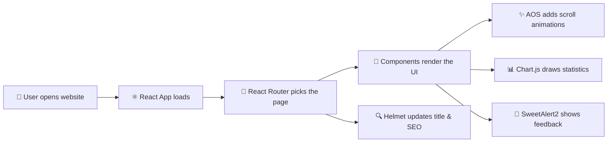

<!-- ===================== HEADER BANNER ===================== -->
<div align="center">


<a href="https://github.com/salwaaymen98-code/univisity_websit">
  
</a>

<br/>


</div>

---

## 📑 Table of Contents

| # | Section | # | Section |
|:-:|---------|:-:|---------|
| 1 | [📖 About the Project](#-about-the-project) | 6 | [🚀 Getting Started](#-getting-started) |
| 2 | [✨ Key Features](#-key-features) | 7 | [📜 Available Scripts](#-available-scripts) |
| 3 | [🛠️ Tools & Technologies](#️-tools--technologies) | 8 | [📂 Project Structure](#-project-structure) |
| 4 | [🧠 Skills Gained](#-skills-gained) | 9 | [🖼️ Screenshots](#️-screenshots) |
| 5 | [⚙️ How It Works](#️-how-it-works) | 10 | [👩‍💻 Author](#-author) |

---

## 📖 About the Project

**University Website** is a capstone project that presents a university's information through a clean, modern, and easy-to-navigate interface.

The goal of the project is to give students, parents, and visitors a **fast and friendly way** to explore the university online, whether they are using a desktop computer, a tablet, or a mobile phone.

> 💡 **Why this project?**
> Many university websites are outdated, slow, or hard to use on mobile. This project solves that with a **responsive, component-based React application** that adapts smoothly to any screen size.

### 🎯 Project Goals

- Provide a **professional online presence** for the university
- Deliver a **seamless experience on all devices**
- Make information **easy to find** with simple navigation
- Use **modern web technologies** and best practices

---

## ✨ Key Features

<table>
  <tr>
    <td width="50%" valign="top">

### 📱 Fully Responsive
The layout automatically adjusts to desktops, tablets, and phones using flexible grids and media queries, so content always looks right.

### 🧭 Multi-Page Navigation
Users move between pages instantly without full page reloads, thanks to client-side routing.

### 🎞️ Smooth Scroll Animations
Sections fade and slide in as the user scrolls, making the site feel alive and modern.

    </td>
    <td width="50%" valign="top">

### 📊 Interactive Charts
Statistics are displayed in clear, animated charts that are easier to understand than raw numbers.

### 🔔 Friendly Alerts & Pop-ups
Clean, attractive messages confirm actions and give instant feedback to users.

### 🔍 SEO-Friendly Pages
Each page has its own title and meta tags to help search engines understand and rank the website.

    </td>
  </tr>
</table>

---

## 🛠️ Tools & Technologies

### 🧱 Core Stack

<div align="center">
  
</div>

<br/>

| Icon | Technology | What it is | How it is used in this project |
|:----:|------------|------------|--------------------------------|
|  | **React** | A JavaScript library for building user interfaces from reusable components | Builds every part of the website (navbar, sections, cards, footer) as independent components |
|  | **JavaScript (ES6+)** | The programming language of the web | Handles the logic, state, and interactivity of the app |
|  | **HTML5** | The standard markup language for web pages | Defines the structure and meaning of the page content (via JSX) |
|  | **CSS3** | The language used to style web pages | Controls colors, layout, spacing, and responsive behavior |
|  | **Node.js** | A JavaScript runtime outside the browser | Runs the development server and build tools |
|  | **npm** | The package manager for JavaScript | Installs and manages all project libraries |

### 📦 Libraries & Packages

<div align="center">


</div>

<br/>

| Library | Category | What it does | Why it was chosen |
|---------|----------|--------------|-------------------|
| 🧭 **`react-router-dom`** | Routing | Lets the app have multiple pages and URLs without reloading the browser | Gives a fast, app-like navigation experience |
| 📊 **`chart.js`** | Data visualization | Draws charts (bar, line, pie, doughnut) on a canvas | Simple, lightweight, and highly customizable |
| 🔔 **`sweetalert2`** & **`sweetalert2-react-content`** | UI feedback | Shows beautiful pop-ups, confirmations, and alerts with React content | Much more attractive than the default browser `alert()` |
| ✨ **`aos`** | Animation | Triggers animations when elements scroll into view | Adds polish with almost no code |
| 🎨 **`react-icons`** | Icons | Provides thousands of icons from popular icon packs as React components | One package, many icon styles, easy to resize and color |
| 🔍 **`react-helmet-async`** | SEO | Changes page title and meta tags dynamically for each page | Improves search engine visibility and sharing previews |
| 🌬️ **`tailwindcss`** | Styling | Utility-first CSS framework for building designs quickly | Faster styling and consistent design |

### 🧰 Development & Workflow Tools

<div align="center">
  
</div>

<br/>

| Icon | Tool | Purpose |
|:----:|------|---------|
|  | **Git** | Tracks changes in the code and keeps a full history of the project |
|  | **GitHub** | Hosts the code online and makes collaboration and sharing easy |
|  | **Visual Studio Code** | The code editor used to write and organize the project |
|  | **Terminal / PowerShell** | Used to run commands, install packages, and start the app |

---

## 🧠 Skills Gained

<div align="center">
  
</div>

<br/>

<table>
  <tr>
    <th align="left">Skill</th>
    <th align="left">What it means</th>
    <th align="left">Where it was applied</th>
  </tr>
  <tr>
    <td>🎨 <b>Responsive Web Design</b></td>
    <td>Creating layouts that adapt to any screen size</td>
    <td>Media queries, flexible grids, and mobile-first thinking across all pages</td>
  </tr>
  <tr>
    <td>⚛️ <b>Component-Based Development</b></td>
    <td>Splitting the UI into small, reusable pieces</td>
    <td>Navbar, footer, cards, and sections built as React components</td>
  </tr>
  <tr>
    <td>🧭 <b>Client-Side Routing</b></td>
    <td>Moving between pages without refreshing the browser</td>
    <td>Page navigation using React Router</td>
  </tr>
  <tr>
    <td>📊 <b>Data Visualization</b></td>
    <td>Turning raw numbers into understandable visuals</td>
    <td>Statistics displayed using Chart.js</td>
  </tr>
  <tr>
    <td>✨ <b>UI / UX & Animation</b></td>
    <td>Designing pleasant and intuitive user experiences</td>
    <td>Scroll animations, icons, and interactive alerts</td>
  </tr>
  <tr>
    <td>🔍 <b>SEO Fundamentals</b></td>
    <td>Making pages discoverable by search engines</td>
    <td>Dynamic titles and meta tags with React Helmet</td>
  </tr>
  <tr>
    <td>🌿 <b>Version Control</b></td>
    <td>Tracking and sharing code changes safely</td>
    <td>Using Git and GitHub to manage the project</td>
  </tr>
  <tr>
    <td>🧩 <b>Debugging & Problem Solving</b></td>
    <td>Finding and fixing errors in code and setup</td>
    <td>Resolving dependency, build, and layout issues</td>
  </tr>
</table>

---

## ⚙️ How It Works



1. The user opens the website and **React** loads the application.
2. **React Router** decides which page to show based on the URL.
3. The page is built from reusable **components**.
4. Extra libraries enhance the experience: **AOS** for animations, **Chart.js** for charts, **SweetAlert2** for pop-ups, and **Helmet** for SEO.

---

## 🚀 Getting Started

### ✅ Prerequisites

Make sure you have these installed:

- [Node.js](https://nodejs.org/) (LTS version recommended)
- npm (comes with Node.js)
- [Git](https://git-scm.com/)

### 📥 Installation

```bash
# 1️⃣ Clone the repository
git clone https://github.com/salwaaymen98-code/univisity_websit.git

# 2️⃣ Move into the project folder
cd univisity_websit

# 3️⃣ Install all dependencies
npm install

# 4️⃣ Start the development server
npm start
```

🌐 Then open **[http://localhost:3000](http://localhost:3000)** in your browser.

> ⚠️ **Tip:** If you see a warning about vulnerabilities after `npm install`, you can safely ignore it for local development. Avoid running `npm audit fix --force`, as it may break the project.

---

## 📜 Available Scripts

| Command | Description |
|---------|-------------|
| `npm start` | ▶️ Runs the app in development mode at `http://localhost:3000` with live reload |
| `npm test` | 🧪 Launches the test runner in interactive watch mode |
| `npm run build` | 📦 Builds an optimized production version into the `build` folder |
| `npm run eject` | ⚠️ One-way operation that exposes all configuration files (not recommended) |

---

## 📂 Project Structure

```
univisity_websit/
│
├── 📁 public/              # Static files (index.html, favicon, images)
│
├── 📁 src/                 # Application source code
│   ├── 📁 components/      # Reusable UI components
│   ├── 📁 pages/           # Website pages
│   ├── 📁 assets/          # Images, fonts, and media
│   ├── 📄 App.js           # Main app component and routes
│   └── 📄 index.js         # Entry point of the application
│
├── 📄 .gitignore           # Files ignored by Git
├── 📄 package.json         # Project info and dependencies
└── 📄 README.md            # Project documentation
```

> 📝 *The structure above is a general overview. Adjust folder names to match your actual project.*

---

## 🖼️ Screenshots

<!-- Replace the paths below with your real screenshots, e.g. put images in a "screenshots" folder -->

| 💻 Desktop | 📱 Mobile |
|:----------:|:---------:|
|  |  |

---

## 🔮 Future Improvements

- [ ] Add multi-language support (Arabic / English)
- [ ] Add a dark mode toggle
- [ ] Connect to a backend for dynamic content
- [ ] Add a student login portal

---

## 👩‍💻 Author

<div align="center">

<a href="https://github.com/salwaaymen98-code">
  
</a>

**Salwa Aymen**
*Front-End Developer*

</div>

---

<div align="center">

### ⭐ If you like this project, please give it a star!

*Bootstrapped with [Create React App](https://github.com/facebook/create-react-app)*


</div>
